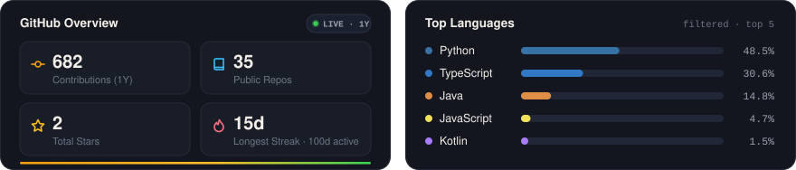

<picture>
  <source media="(prefers-color-scheme: dark)" srcset="./assets/hero-lofi-dark.svg" />
  <source media="(prefers-color-scheme: light)" srcset="./assets/hero-lofi-light.svg" />
  
</picture>

 

<picture>
  <source media="(prefers-color-scheme: dark)" srcset="./assets/stats-cards-dark.svg" />
  <source media="(prefers-color-scheme: light)" srcset="./assets/stats-cards-light.svg" />
  
</picture>

 

<picture>
  <source media="(prefers-color-scheme: dark)" srcset="./assets/activity-graph-dark.svg" />
  <source media="(prefers-color-scheme: light)" srcset="./assets/activity-graph-light.svg" />
  
</picture>

 

### Tech Stack

<picture>
  <source media="(prefers-color-scheme: dark)" srcset="https://skillicons.dev/icons?i=ts,py,java,kotlin,cpp,go,rust,nextjs,react,angular,tailwind&theme=dark" />
  <source media="(prefers-color-scheme: light)" srcset="https://skillicons.dev/icons?i=ts,py,java,kotlin,cpp,go,rust,nextjs,react,angular,tailwind&theme=light" />
  
</picture>

<picture>
  <source media="(prefers-color-scheme: dark)" srcset="https://skillicons.dev/icons?i=fastapi,spring,nodejs,postgres,redis,mongodb,docker,kubernetes,terraform,aws,gcp,cloudflare&theme=dark" />
  <source media="(prefers-color-scheme: light)" srcset="https://skillicons.dev/icons?i=fastapi,spring,nodejs,postgres,redis,mongodb,docker,kubernetes,terraform,aws,gcp,cloudflare&theme=light" />
  
</picture>

 

<picture>
  <source media="(prefers-color-scheme: dark)" srcset="./assets/pacman-contribution-graph-dark.svg" />
  <source media="(prefers-color-scheme: light)" srcset="./assets/pacman-contribution-graph.svg" />
  
</picture>

 

<a href="https://www.tiktok.com/@caubethang2_">TikTok (@caubethang2_)</a> &nbsp;·&nbsp; <a href="https://github.com/Coffat">GitHub (@Coffat)</a>

